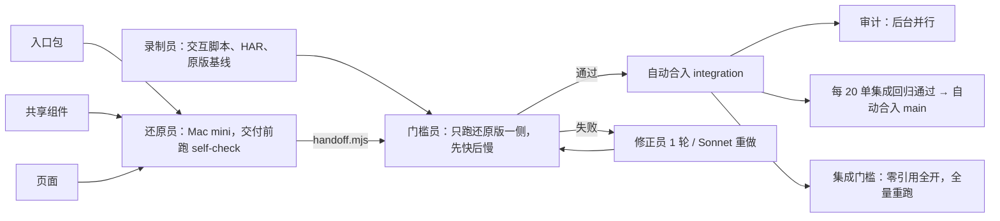

# Vue 反编译多 Agent 编排：Multica 创建说明（v3.2）

Oct 9, 2026 · @Dylan Lee · 修订：Mika

v3 的目标是**尽可能并行、尽快完成**。v3.1 按《哈密公共就业服务网前端还原：全局说明》对齐：还原产物落到 `hmrsfw-vue` 工程，模型分工按全局说明第四节，新增第十三节「公共库统一」和第十四节「全局约束」。v3.2 改为**智能体自治**：`done` 由智能体按机器判据设置，`main` 由回归通过后自动合并，只有第十五节列出的事情才升级给人。和 v2 相比的改动见文末「修订记录」。第十二节「接口约定」是几个并行工程子任务共同遵守的契约，改动它要先在父任务里说明。

## 一、已定项

| 项 | 取值 |
| --- | --- |
| 产物工程 | `/Users/dylan/Projects/hmrsfw-vue`：最终交付的 Vue 工程，已有 30 页、入口层、共享层、接口模块。还原员只往这里写 |
| 仓库 | 两个 GitHub 私有仓库（2026-10-09 已定）：`libingtong/hmrsfw-vue`（产物，只放干净源码，分支 `main` / `integration` / `restore/*`）+ `libingtong/hmrsfw-restore`（工具、`legacy-dist`、映射、工单、回执、`registry`） |
| 分支 | `main`（集成回归通过后自动合并）、`integration`（门槛通过后自动合并）、`restore/<工单id>-a<attempt>`（每次尝试） |
| Mac mini（`DylandeMac-mini.local`，16GB） | **唯一运行机器**（2026-10-15 起，HM-212）：全部智能体，见第四节。持有 HAR、登录态、SM2 私钥 |
| Office-Server（`Dylan-Office-Server`） | **已停用**（2026-10-15）。原先放主力还原员和审计员；因 Claude 命令行路径失效、GitHub 凭据和仓库缓存反复出问题而停用，派单不再指向它 |
| `RESTORE_ASSETS`（仅 Mac mini） | `/Users/dylan/Projects/hmrsfw-restore-poc` |
| `RESTORE_STATE`（仅 Mac mini） | `/Users/dylan/Projects/hmrsfw-restore-state`：账本、能力表、锁、门槛产物、原版基线、修正 diff |
| 模型 | 页面默认 Sonnet 5.5；入口包、共享组件、修正用 Opus 5.5；DeepSeek `deepseek-official/deepseek-flash`、GLM `zhipuai-coding-plan/glm-5.3-flash` 作为便宜档，**小样本重测通过后**才启用，且只接 < 30KB 的页面；Codex 审计。**不用 Haiku** |
| 交互比对 | 写请求不发出，返回 HAR 里录制的响应；按解密后的请求体匹配 |
| 白名单 | 取消 |
| 范围 | 哈密：门户 161 页 + 用户中心 133 页 + 共享组件 90 + 入口包 ≤ 48；**≥ 30KB 的页面一律分段**；`hmrsfw-vue` 里已验收的 30 页不再派还原单，只做回归 |
| 裁定 | 裁定员（智能体，Opus 5.5）处理自动流程走不通的工单；只有第十五节的事项才升级给李炳通 |
| 【漏检率阈值】 | 10% |
| 【预算上限】 | 暂不设，前 50 页跑完后按实际用量定 |

## 二、前置工程（并行拆分）

由父任务「Vue 还原流水线：前置工程」统一推进，分三个阶段：

| 阶段 | 子任务 | 产出 |
| --- | --- | --- |
| 1 | S1 仓库初始化 | 仓库主干、`integration` 分支、`.gitignore`、`tools/setup-workdir.mjs`、本文档入库为 `docs/pipeline.md` |
| 2 | A 门槛 | `gate.mjs`（并发安全、只跑还原版一侧、先快后慢、单页构建、解密体匹配 HAR、共享组件顶替、集成模式）、`baseline.mjs`（原版基线） |
| 2 | B 调度 | `tick.mjs`、`route.mjs`、`ledger.mjs`、`handoff.mjs`、自动合并到 `integration` |
| 2 | C 工单、公共库清单与自检 | `work-orders.mjs`、`scan-shared-gaps.mjs`、公共库清单 `registry`（第十三节）、≥ 30KB 分段、`self-check.mjs`（含 `check-imports`）（还原员交付前跑的静态检查，含 `check-text-nodes`、`check-directives`） |
| 2 | D 录制 | `record-page.mjs`：交互脚本格式、HAR 录制，录完调用 `baseline.mjs` |
| 2 | E 样式与加密 | `css-by-scope.mjs`、`har-decrypt.mjs`、E5 用的密文 HAR 回放比对；后处理抽取 base64 图片、展开压缩 CSS |
| 3 | F 联调 | 用 20 张确认页把整条脚本链端到端跑通，给出门槛耗时和内存数据 |

阶段 2 的 5 个子任务同时进行，彼此只通过第十二节的接口约定衔接。

v3.2 不再需要自定义状态，只用内置状态（见第十节）。

## 三、整体流程

入口包、共享组件、页面**三条线同时开工**，录制线也同时进行。不再有阶段之间的等待。



1. **派单**：调度员每 5 分钟运行一次 `tick.mjs`，给每个还原员保持「正在跑 + 1 张排队」。大页先派，小页打包。
2. **还原**：还原员拉代码、在新分支还原、跑 `self-check.mjs` 直到静态检查全过（最多 3 次），推分支、写回执，最后运行 `handoff.mjs` 把任务交给门槛员。
3. **门槛**：门槛员跑 `gate.mjs`（页面门槛模式），写结果，运行 `tick.mjs advance` 推进。
   - 该页的录制还没完成：任务留在 `in_review`，`advance` 记为「等录制」，录制完成后由调度员重新送门槛。
4. **通过**：自动合入 `integration`。没抽中审计 → 直接 `done`；抽中 → 负责人改为审计员，状态保持 `in_review`，审计 ok 后 `done`。审计不阻塞其他工单。
5. **失败**：按第九节的失败规则处理。
6. **审计发现问题**：从 `integration` 回退该页的提交，按失败处理。已经 `done` 的页面在之后的回归里失败，同样重开处理。
7. **合入 main**：`integration` 每新合入 20 单（或空闲时，或最早一个还没进 `main` 的合并已等满 24 小时），调度员跑一次整体构建 + 已通过页面全量回归（全局说明第三节），通过就自动把 `integration` 快进合入 `main`；不通过就定位并回退引起问题的提交，再重跑。
8. **集成门槛**：入口包、共享组件全部合入 `integration` 后，对所有页面以集成模式重跑一遍（零引用全开、不再顶替）。失败的页按共享组件或入口包的问题追溯，而不是重做页面。

## 四、智能体清单

**单机运行**（2026-10-15 起）：Office-Server 已停用，全部智能体都在 Mac mini 上，`tick` 只在 Mac mini 上跑（`node tools/tick.mjs tick`，或写明 `--machine mac`）。`restore.config.json` 的 `machines` 只剩 `mac`，承担全部角色。名册（`$RESTORE_STATE/agents.roster.json`）里原 `@Office` 的智能体保留为 `enabled: false`，Multica 里的这些智能体由李炳通确认后统一归档。权限全部设为「仅自己」。

| 名称 | 机器 | 运行时 | 模型 | 名册角色 | 并发（名册当前值） | 职责 |
| --- | --- | --- | --- | --- | --- | --- |
| 调度员 | Mac mini | Claude Code | Sonnet 5.5 | `dispatcher` | 1 | 运行 `tick.mjs`，处理异常 |
| 门槛员 | Mac mini | Claude Code | Sonnet 5.5 | `gate` | 3 | 跑门槛，调用 `advance` |
| 录制员 | Mac mini | Claude Code | Sonnet 5.5 | `recorder` | 2 | 写交互脚本、录 HAR、算原版基线 |
| 修正员 | Mac mini | Claude Code | Opus 5.5 | `fixer` | 2 | 读门槛 diff 修复 |
| 裁定员 | Mac mini | Claude Code | Opus 5.5 | `arbiter` | 2 | 第十五节 |
| 还原-Sonnet@Mac | Mac mini | Claude Code | Sonnet 5.5 | `restorer` | 2 | 页面（默认）、重做 |
| 还原-Opus@Mac | Mac mini | Claude Code | Opus 5.5 | `restorer-core` | 2 | 入口包、共享组件、公共库升级单（接替还原-Opus@Office） |
| 还原-DeepSeek@Mac | Mac mini | dsh | `deepseek-official/deepseek-flash` | `restorer` | 2 | 便宜档页面（< 30KB） |
| 还原-GLM@Mac | Mac mini | Opencode | `zhipuai-coding-plan/glm-5.3-flash` | `restorer` | 1，**停用** | 名册 `enabled: false`，`cheapTier.families` 只有 `deepseek` |
| 复核-Claude@Mac | Mac mini | Claude Code | Sonnet 5.5 | `reviewer` | 2 | 抽检审计、规则变更复核，只读 |
| 复核-DeepSeek@Mac | Mac mini | dsh | `deepseek-official/deepseek-v4-pro` | `reviewer` | 2 | 同上 |
| 复核-GLM@Mac | Mac mini | Opencode | `zhipuai-coding-plan/glm-5.3` | `reviewer` | 2 | 同上 |

复核按家族互斥：审计选与生成、修正家族都不同的复核员；规则变更单选两个与裁定员（anthropic）不同家族的复核员，单机下就是复核-DeepSeek@Mac 和复核-GLM@Mac。三个家族的复核员都在 Mac 上，互斥规则不受单机影响。

**并发评估（16GB，先不调大，以实测为准）**：

原方案让 Mac mini 上的还原员各只开 1，是因为内存要留给门槛和录制。现在 Office 上的还原、复核都搬了过来，同一台 16GB 机器上要同时容纳：

| 负载 | 单个峰值（依据） | 名册当前上限 | 小计 |
| --- | --- | --- | --- |
| 门槛 | 门槛进程 0.2–0.33GB + Chromium 约 0.5GB ≈ 0.8GB（`docs/gate.md` 实测，page 模式）；集成模式进程 0.9GB | 3 | ≈ 2.5GB |
| 录制 | 有界面 Chromium + Playwright ≈ 1GB（估计） | 2 | ≈ 2GB |
| 还原、修正、裁定、复核会话 | 智能体 CLI 0.1–0.2GB（本机 `ps` 实测）+ `self-check` / Vite 编译 ≈ 0.3–0.5GB（估计） | 还原 6 + 修正 2 + 裁定 2 + 复核 6 + 调度 1 | 满载 ≈ 6–8GB，实际复核和裁定很少同时满 |
| 系统、Multica 守护进程、浏览器、本机其他智能体（如 Mika@Mac） | 2026-10-15 测得空闲内存约 43%，已有换页记录 | — | ≈ 5–6GB |

结论：

- **还原员维持名册当前值，不调大**：Sonnet 2、DeepSeek 2、Opus（核心）2，合计 6，GLM 停用。这已经比原方案的「各 1」高，接手了 Office 的入口包和共享组件，再加会挤占门槛。
- 门槛员保持 3，不按原计划提到 5–6：门槛是吞吐瓶颈，但 5–6 个门槛加 6 个还原在 16GB 上大概率触发换页，反而拖慢门槛。
- 复核员各 2 先不动；审计是抽检，实际同时在跑的通常不超过 2 个。
- 调大的条件（满足才逐个 +1，每次只改一个智能体，在名册和 Multica 里同时改）：门槛 3 个并发跑满时 `memory_pressure` 空闲比例持续高于 25%、无新增换页，单张门槛耗时中位数不比 `docs/gate.md` 的 13.5 s 慢 30% 以上。优先给 Sonnet（页面默认模型），其次门槛员。出现内存压力时先降复核员和 DeepSeek。

**家族与路由**：`route.mjs` 按家族路由，同家族的智能体共享能力数据，各自计算空闲并发。Office 时期在 `claims` 分支留下的统计快照（如有）仍计入能力数据。

**环境变量**（`--custom-env-file`，0600）：

| 变量 | 谁有 |
| --- | --- |
| `RESTORE_STATE` | Mac mini 上的全部智能体 |
| `RESTORE_ASSETS`、`SM2_PRIVATE_KEY`、`HMRSFW_NO_WHITELIST=1` | 只有门槛员、录制员 |
| `VITE_HMRSFW_SM2_PUBLIC_KEY`、`VITE_HMRSFW_SM4_KEY`、`VITE_HMRSFW_SM4_STORAGE_KEY` | 门槛员（还原版回放时解密响应、加密请求体；门槛的 worktree 里没有 `.env.local`，缺了门槛报 error，见 `docs/gate.md`。HM-9 联调补） |
| `RESTORE_DEPS_CACHE` | 所有还原员和复核员：本机依赖缓存目录。没设时 `setup-workdir.mjs` 用 `~/Projects/hmrsfw-restore-deps`（该目录存在时），所以 Mac mini 上门槛员、录制员等其他角色也走共享缓存（HM-1130） |

## 五、还原员统一指令

主体原样使用 `tools/prompt-template-confirm.md`，只追加 Multica 段。

**样式**：按全局说明第六节，还原员不写 `<style>`，样式由 `css-by-scope.mjs` 按 scopeId 写入。这个脚本是页面派单的前置条件。模板里如有「自己写样式」的内容，以本条为准。

**公共库**：只按工单 `maps` 给出的路径导入公共代码，见第十三节。

```markdown
<此处原样粘贴 tools/prompt-template-confirm.md 全文，不做任何删改>

---

## Multica 运行约定（追加）

### 开工
1. multica issue metadata list <任务id> --output json，取 workOrders（数组，可能一单含多页）、branch、attempt。
2. multica repo checkout https://github.com/libingtong/hmrsfw-restore --ref integration，然后 git checkout -b <branch>。
3. 运行 node tools/setup-workdir.mjs。
4. 逐张读 queue/<工单id>.json 及其中列出的文件。不要读工单以外的页面和产物，不要读本仓库以外的目录。

### 交付前自检
对每张工单运行 node tools/self-check.mjs <工单id>。有失败项就按输出修改，再跑，最多 3 次。3 次后仍失败也照常交付，把剩余失败项写进回执 unresolved。

### 交付
1. 在 <branch> 上提交并 git push origin <branch>。
2. 每张工单一份回执 receipts/<工单id>.json，格式沿用上文模板，另加 "id"、"branch"、"selfCheck"（最后一次自检结果）。随分支提交。
3. 运行 node tools/handoff.mjs <任务id>。它会写元数据、评论 [RECEIPT] 并把任务交给门槛员。不要自己改状态或负责人。

### 禁止
- 不要修改工单、tools/ 下的脚本、其他页面或骨架共享文件。
- 不要 @ 任何智能体，不要把状态改为 done。
- 除了 git push 到上述仓库，不要访问任何网络服务。

### 卡住时
仍然写回执，把原因写进 unresolved，推分支，运行 handoff.mjs。不要编造空实现来凑数。
```

## 六、修正员、审计员、录制员指令

### 修正员（Mac mini）

```markdown
# 角色：Vue 还原修正员

你修复没有通过门槛的还原结果，只改错的地方，不重写整个文件。

## 输入
- 元数据 workOrders、branch、fixRound、gate.<attempt>.diff（$RESTORE_STATE/gate/ 下的本机路径）。
- 工单里的 target、subComponentDir、sourceChunk、maps。

## 开工
multica repo checkout https://github.com/libingtong/hmrsfw-restore，git checkout <branch>，运行 node tools/setup-workdir.mjs。

## 要求
1. 先对照 sourceChunk 确认 diff 指出的每一处差异的原因，再改。
2. 只修改 target 和 subComponentDir 下的文件。
3. 差异来自骨架、共享层或门槛脚本自身时不要改，在回执 needsFromSkeleton 里写明，notes 写“疑似共享层问题”和依据。
4. 跑 self-check.mjs 通过后提交并 push。

## 输出
1. 更新回执，notes 追加本轮修改要点，每处一行。
2. 运行 node tools/handoff.mjs <任务id> --fix。

## 禁止
- 不要 @ 任何智能体，不要改为 done，不要改门槛脚本或归一化规则。
- 只读 $RESTORE_STATE/gate/ 下本任务的 diff，不读 $RESTORE_ASSETS。
- diff 里的测试数据不得写进代码、回执或评论。
```

### 审计员（复核员，Mac mini）

和 v2 相同，只改两处：拉代码用 `--ref integration` 再 checkout 分支；审计不阻塞，结论写进元数据 `audit.<attempt>` 后评论 `[AUDIT]`，由调度员下一轮处理。

### 录制员（Mac mini）

```markdown
# 角色：页面录制员

你为一张页面工单准备门槛所需的测试资产。你不写还原代码。

## 步骤
1. 读元数据 workOrders，取工单的 recordPath、sourceChunk。
2. 读原 chunk，找出页面上的交互：查询、重置、翻页、表单校验、提交、弹窗、tab 切换。
   按 docs/pipeline.md 第十二节的交互脚本格式写 tests/interact/<工单id>.json。
   - 优先覆盖会发请求的操作，每页 3–8 步。
   - 填写值用明显的测试值（如“测试”“Tst-0001”），不要用真实姓名、手机号、身份证号。
   - 组件在页面加载完时还没挂载（点开才出现的弹窗、不是第一个的 tab 内容；常见于 recordVia 工单）：在打开它的那一步加 `"root": true`，原版基线和门槛都在这一步之后取根。弹窗是 v-if 的，取根前不要关掉它（HM-1294）。
3. 运行 node tools/record-page.mjs <工单id>。它会：
   - 在测试环境真实执行一遍，录 HAR 到 $RESTORE_ASSETS/har/pages/<工单id>.har；
   - 用 HAR 回放原版并缓存原版基线到 $RESTORE_STATE/baseline/<工单id>/；
   - 把交互脚本提交到仓库 integration 分支（只提交脚本，不提交 HAR）。
   - 本机同时录制的不超过 HMRSFW_RECORD_SLOTS（默认 3）个，其余排队最多 --wait-slot 分钟（默认 9）。等不到时报 `recording slots … busy`，不是页面问题，过一会重跑（HM-1221）。
4. 脚本报告某一步在原版上就无法稳定复现（两次回放结果不同）：删掉这一步，重跑。
5. 需要其他角色账号才能访问的页面：元数据写 record=blocked:<原因>，评论 [RECORD] blocked，结束。
6. 成功：元数据写 record=ok，评论 [RECORD] ok <步数>。

## 禁止
- 不要把 HAR、登录态、接口返回的数据写进仓库、评论或元数据。
- 不要 @ 任何智能体，不要改为 done。
```

录制时，`tools/record-write-denylist.json` 里的写接口（提交、新增、保存、发布、修改、删除、撤销、报名、投诉咨询反馈等）不发到测试环境，由 `tools/record-write-guard.mjs` 用固定的成功响应 `{"success":true,"code":200,"result":null,"message":"intercepted"}` 回答（明文、不带 `crypto_opt` 头，两个应用只在该头为 `true` 时才解密），HAR 条目带 `_intercepted`、`_interceptRule`，`writes.json` 和录制结果里单列 `intercepted`，与真实发出的 `writes` 分开（HM-992）。名单按接口路径的正则和末段驼峰分词（`staggingOrSubmit` 里的 submit、`companyPositionAdd` 里的 add）匹配，GET 的写接口（`scanPay`、`refresh`、`downPdf`）和登录类接口（硬规则 2）也拦；名单默认拦截，放行项逐条写理由（如招聘会浏览计数 `updateBrowseCount`、身份切换用到的三个接口）。`tools/test/record-write-guard.test.mjs` 会把 `legacy-dist` 里声明的全部接口过一遍：查询动词开头的一个都不拦，已知写接口全拦。没进名单、方法是 POST、末段又不像查询的请求照常发出，并列进录制结果的 `warnings`（`unlisted write? …`），请人补进名单。逐个核对某条路径：`node tools/record-write-guard.mjs POST <路径>`。名单外的写入仍会到测试环境，全部录完后人工重置一次测试环境。门槛运行时不需要测试环境。

## 七、门槛员指令与门槛要求

### 门槛员指令

```markdown
# 角色：还原门槛员

你对一张已交付的还原任务跑机器门槛。你不写也不改任何还原代码。

## 步骤
1. 读元数据 workOrders、branch、attempt。
2. multica repo checkout https://github.com/libingtong/hmrsfw-restore，git checkout <branch>，运行 node tools/setup-workdir.mjs。
3. 页面单、公共库升级单：运行 node tools/gate.mjs --task <任务id> --branch <branch> --mode page；公共库升级单（kind=upgrade，元数据 gateMode=upgrade）用 --mode upgrade（gate.mjs 读到 kind=upgrade 也会自动切换）。
   **集成单（kind=integration）**：前台运行 node tools/gate.mjs --task <任务id> --mode integration --app "$HMRSFW_APP_DIR"（Bash 超时 600000 ms）。输出 {"partial":…}（退出码 3）就**原样再跑同一条命令**，直到输出结论、{"pending":…} 或 {"error":…}，才进第 4 步；**不要转后台、不要 nohup、不要在命令还没出结论时结束运行**——266 页全量回归要 1.5–2 小时，一次性跑完必定超过前台/后台时限被杀掉、无输出（HM-1176、HM-1072 的教训，分段续跑的设计见 docs/gate.md「集成模式分段续跑」）。
4. 运行 node tools/tick.mjs advance <任务id>。gate.mjs 已经写好元数据和 [GATE] 评论，不需要你再写。

## 异常
- gate.mjs 输出 {"error":...}（构建环境、端口、浏览器启动等门槛自身的问题），或检出、setup-workdir 等前置步骤失败：评论 [GATE] ERROR <一行原因>（写原始报错，如 `page.screenshot: Timeout 30000ms exceeded`），不调用 advance，结束。环境类错误由调度器退避后自动重送门槛，其余交裁定员（docs/scheduler.md「门槛没有结论」）。
- 集成单跑到一半被杀、或你自己结束了运行：没有结论，也不要调用 advance；下次重跑同一条命令会从已判的页接着跑（24 小时内）。
- 不要为了让门槛通过而修改门槛脚本、归一化规则或 HAR。
- 不要 @ 任何智能体，不要改为 done。
```

### gate.mjs 要求

1. **并发安全**：服务器监听端口 0；全部产物写 `$RESTORE_STATE/gate/<工单id>-a<attempt>/`；构建产物写在各自工作目录；不写任何共用的追加文件；HAR 和基线只读。
2. **只跑还原版一侧**：原版一侧的 DOM、文本、截图、请求序列由录制阶段缓存在 `$RESTORE_STATE/baseline/<工单id>/`，门槛直接读取。基线不存在时输出 `{"pending":"record"}`。
3. **先快后慢，失败即停**：
   1. 静态：编译、组件数、文本节点、指令、render AST、复制内容、个人信息扫描（复用 `self-check.mjs`）；
   2. 构建：只构建本页（单页入口或 Vite 按需编译），不构建整站；
   3. 浏览器：HAR 回放、交互比对，同一进程内复用一个浏览器实例。
4. **写请求匹配**：先按「方法 + 路径 + 解密并归一化后的请求体」找 HAR 记录；找不到时退回按「方法 + 路径」取第一条；都找不到返回统一的「not in HAR」。
5. **共享组件顶替（page 模式）**：本页依赖的共享组件或入口导出在 `integration` 上还没有还原版时，用原编译 chunk 的薄包装顶替。零引用检查只对本页自己的文件生效。输出里列出本次顶替了哪些模块。
6. **集成模式（`--mode integration`）**：不顶替，零引用检查全开，可以一次跑多页。
   **升级单模式（`--mode upgrade`）**：静态阶段按公共库改动的范围判（与调度器合并时同一个判定函数），再对改动文件做编译、零引用、个人信息扫描；整站构建；对依赖改动文件的已通过页面跑 integration 模式回归。要解挂的页面不在这里判（HM-990，见 `docs/gate.md`）。
7. **输出**（stdout 一行 JSON，同时写入元数据 `gate.<attempt>`）：`{pass, failed:[...], stage:"static|build|browser", diff, shimmed:[...], durationMs}`。

## 八、路由规则与抽检率

与 v2 相同，补充以下几点：

- **便宜档（全局说明 D1）**：先做小样本重测（POC 中 Haiku 失败过的 5 页 + 若干留出页，DeepSeek、GLM 各跑一次，按金额和首通率判断）。通过前页面一律派 Sonnet。启用后只接 < 30KB 的页面，冷启动期 DeepSeek 和 GLM 双派（分支后缀 `-d`、`-g`），先通过者合并，另一个只记账。
- **大页先派**：同一优先级内按 chunk 大小降序派单。
- **小页打包**：< 5KB 的页面 3–5 张打成一单（`workOrders` 数组），同一还原员一次做完。门槛逐页判定，失败的页拆成单页工单重做，通过的页照常合并。
- **预排队**：每个还原员保持「正在跑的 + 1 张排队」。
- **入口包、共享组件、页面同时派**：三类工单之间不再有先后约束。入口包和共享组件的优先级高于页面，能更早减少顶替。

## 九、调度员指令与状态机

调度员指令与 v2 相同，触发间隔改为 5 分钟。`tick.mjs` 每轮的步骤：

1. **同步**：任务列表、账本、智能体状态（冷却、降级）。
2. **处理失败的运行**：限流或额度不足 → 冷却 30 分钟并改派同家族另一台机器的智能体，没有就改派下一个候选。环境类失败 → 同一智能体重跑一次，再失败换候选。
3. **兜底送门槛**：`in_review` 但负责人仍是还原员或修正员的任务（说明 `handoff.mjs` 没跑成）→ 交给门槛员。
   **门槛没有结论**：负责人是门槛员、本轮运行已结束却没有 `gate.<attempt>` 的任务（门槛自身出错，或门槛员没跑门槛）→ 环境类错误退避后自动重送门槛（30 / 60 / 120 分钟，最多 3 次），其余或超过次数 → 排障单交裁定员（HM-1306，见 `docs/scheduler.md`）。
4. **等录制的任务**：门槛要求重录之后完成了录制的 → 重新交给门槛员（旧录制不算；同一原因连续两次 `pending:record` 交裁定员，见 `docs/scheduler.md`「等录制」）。
5. **处理审计结果**：ok → `done`。有 high 或 medium → 从 `integration` 回退该页提交，按失败规则处理，计一次漏检。只有 low → `done`，low 级发现记进每日摘要。
6. **派录制单**：给录制员保持「正在跑的 + 1 张排队」，按页面派单顺序录制，保证录制领先于还原。
7. **派新单**：按第八节。
8. **集成门槛**：入口包和共享组件全部合入 `integration` 后，建一张集成门槛任务交给门槛员。
9. **记账与监控**：停止条件触发时先暂停派新单，建一张「排障单」交给裁定员处理根因（如连续同类失败 → 公共库升级单或规则变更单），处理完由裁定员恢复自动化。只有第十五节的事项才升级给人。另加一条停止条件：集成门槛失败率 > 10%。

**`advance` 的失败规则**（按顺序取第一条适用的）：

1. 修正员还没修过这次尝试的分支 → 修正员在同一分支修 1 轮。
2. Sonnet 还没试过 → 还原-Sonnet 重做（新分支）。
3. Sonnet 分支的修正轮数 < 2 → 修正员再修一轮。
4. 否则 → 指派裁定员（见第十五节）。裁定员也解决不了且属于第十五节的事项，才 `blocked` 并指派李炳通。

**`advance` 通过时**：加锁合入 `integration`（`git merge --no-ff`；冲突则放弃合并，按失败处理并标记 `merge_conflict`），没抽中 → `done`；抽中 → 负责人改为审计员（状态保持 `in_review`），审计员写完元数据后由调度员处理。

**并发安全**：与 v2 相同（工单锁、账本锁、幂等创建），另加 `locks/integration`：合并和回退 `integration` 时持有。

## 十、任务约定与人工裁定

| 状态 | 含义 | 谁设置 |
| --- | --- | --- |
| todo | 已派单 | 调度员 |
| in\_progress | 执行中 | 还原员 / 修正员 / 录制员 / 裁定员 |
| in\_review | 已交付，等门槛、等录制、正在跑门槛，或正在审计 | `handoff.mjs` / `tick.mjs` |
| blocked | 只用于第十五节的事项，等人处理 | 裁定员 |
| done | 门槛通过、已合入 `integration`、抽中时审计 ok | `tick.mjs`（智能体） |
| cancelled | 双派落选、作废的工单 | `tick.mjs` |

- `done` 由智能体按机器判据设置，不等人。之后的回归或审计发现问题，由调度员重开。
- 评论标签：`[RECEIPT]`、`[FIX]`、`[GATE]`、`[AUDIT]`、`[RECORD]`、`[REDO]`、`[BLOCKED]`。脚本只读元数据，评论给人看。
- 录制工单单独成任务，标题 `[record] <工单id>`；还原工单标题 `[restore] <工单id>`。
- 自动化：「还原调度轮次」，执行者调度员，仅运行，每 5 分钟一次 + webhook。
- 「调度日志」任务：调度员每轮评论摘要，你订阅。
- 你随时可以抽看 `main` 或 `integration`；发现问题在任务里评论，调度员会把它当作审计 issue 处理。

**已知风险**（v2 的 1–6 仍然成立，以下为新增或变化）：

1. 风险 1（本机隔离）：Office-Server 停用后，全部还原员和 HAR、登录态、私钥在同一台 Mac mini 上，物理隔离不再成立，只靠环境变量（还原员不拿 `RESTORE_ASSETS`、`SM2_PRIVATE_KEY`）和指令约束。
2. **顶替带来的假通过**：page 模式下用原编译产物顶替共享组件，页面通过不代表接上还原版共享组件后也通过。集成门槛兜底。
3. **双派浪费**：冷启动期便宜模型用量约翻倍。
4. **录制写测试环境**：录制期间的写入会改变测试数据，影响后续页面的录制内容，但每页的 HAR 自洽，不影响比对。全部录完后人工重置一次。
5. **`integration` 回退**：审计发现问题时要回退已合入的页面。页面只改自己的文件，回退一般不冲突。

## 十一、自检

前置工程阶段 3（F 联调）完成后，Mika 再创建智能体和自动化，然后按下面的步骤自检：

- [ ] 12 个智能体都在指定机器上在线，模型 ID 与第四节一致，还原员指令逐字相同。
- [ ] 每个还原员各做一张最小的页面工单：`self-check` 跑了、分支推了、回执合规、`handoff` 把任务交给了门槛员。
- [ ] 门槛员同时跑 3 张，无冲突；记录单张耗时和 Mac mini 内存峰值，据此把门槛员并发提到 5–6。
- [ ] 至少一张页面包含写操作，确认写请求命中了 HAR 里的真实响应，页面走了成功分支。
- [ ] 故意制造一次门槛失败，确认先交给修正员在原分支修 1 轮。
- [ ] 双派：同一工单的两个便宜模型都跑完，只有先通过的那个合入了 `integration`。
- [ ] 同时手工触发 3 轮调度员，确认没有重复建任务。
- [ ] 一轮由定时触发的派单能成功指派。
- [ ] 观察智能体自己的评论会不会再次触发它。

## 十二、接口约定（并行子任务共用）

**目录与文件**

| 路径 | 内容 | 谁写 |
| --- | --- | --- |
| `queue/<工单id>.json` | 工单，字段见 `batch-plan.md` 第 3 节，另加 `type`（entry/shared/page/segment）、`kb`、`deps`（依赖的共享组件和入口导出）、`recordPath`、`site`；page/segment 另有 `role`（录制身份，取值同 `record-page.mjs` 的 `IDENTITIES`：`general` / `jobseeker` / `corp` / `mentor`；门户写 `general`；用户中心按路由和原 chunk 判定，判不出写 `null` 并在 `notes` 写原因，`record-page.mjs` 遇到 `null` 输出 `blocked: need-role-decision`，不猜；自动规则判不出的页面由裁定员按原 chunk 判定，写在 `tools/uc-role-decisions.json`（`decided` 写入 `role`，其 `limit`（这个身份录不到的部分）和 `dataNeed`（造数需求，D7）写进 `notes`，`dataNeed` 另汇总到 `queue/data-needs.json`，全部页面录完后统一交人造数；`pending` 仍为 `null`、`notes` 写建议和需要人确认的事）；判定依据见 `queue/roles.json`） | C |
| `registry/<app>.json` | 公共库清单，见第十三节 | C 生成，之后只由入口包、共享组件工单更新 |
| `tests/interact/<工单id>.json` | 交互脚本：`[{"fill":[placeholder,value]} \| {"click":text} \| {"clickSel":css,"optional":bool} \| {"wait":ms}]`，与 POC 的 `interact-scripts.mjs` 同义。任一个动作或等待步骤可带 `"root": true`（至多一步）：页面根在这一步之后取，而不是加载完时取，这时取到的 DOM、文本、浮层、截图按加载根的判据比对，请求仍按原阶段归入加载集合或步骤序列（HM-1294，`tools/gate/replay.mjs` runPage，两侧相同） | 录制员 |
| `receipts/<工单id>.json` | 回执 | 还原员、修正员 |
| `$RESTORE_ASSETS/har/pages/<工单id>.har` | 页面 HAR | `record-page.mjs` |
| `$RESTORE_STATE/baseline/<工单id>/` | 原版基线：`dom.html`、`text.txt`、`shot.png`、`seq.json`（请求序列，请求体只存 SHA-256） | `baseline.mjs`（A），由 `record-page.mjs`（D）调用 |
| `$RESTORE_STATE/baseline/<工单id>/coverage.json` | 原版 JS 覆盖率（HM-21）：本页 chunk 和 `deps.shared` 共享组件 chunk 的函数覆盖率、块覆盖率（两次回放取并集）、`stable`，以及未覆盖项清单（chunk 内位置、弹窗/Tab/表单等上下文、事件名、静态文案、`needs`: interaction / data / unknown）。`baseline.json` 另有键 `coverage` 放摘要。只作用于原版一侧，不进入门槛的比对输入 | `baseline.mjs` |
| `$RESTORE_STATE/gate/<工单id>-a<attempt>/` | 门槛产物和 diff | `gate.mjs` |
| `$RESTORE_STATE/ledger/` | `capability.json`、`agents.json`、`runs.jsonl` | `ledger.mjs` |
| `$RESTORE_STATE/locks/` | `wo-<工单id>`、`ledger`、`integration` | `tick.mjs`、`handoff.mjs` |

**任务元数据键**

| 键 | 值 |
| --- | --- |
| `workOrders` | 工单 id 数组 |
| `kind` | `restore` / `record` / `integration` |
| `branch`、`attempt`、`fixRound` | 当前尝试 |
| `history` | 历次尝试：`[{attempt, agent, family, branch, result, failed}]` |
| `twin` | 双派时另一张任务的 id |
| `gate.<attempt>` | `gate.mjs` 的输出 |
| `audit.<attempt>` | 审计结论 |
| `record` | `ok` / `blocked:<原因>` |

**命令行**

| 命令 | 输出 |
| --- | --- |
| `self-check.mjs <工单id>` | `{pass, failed:[{check, where, hint}]}`，不需要 `RESTORE_ASSETS` |
| `gate.mjs --task <id> --branch <b> --mode page\|integration\|upgrade` | 见第七节、`docs/gate.md` |
| `handoff.mjs <任务id> [--fix]` | 写元数据、评论、状态 `in_review`、负责人改为门槛员 |
| `tick.mjs tick` / `tick.mjs advance <任务id>` | `{ok, summary, anomalies:[{issue, what, suggestedAction}]}`；拿不到锁输出 `{"locked":true}` |
| `route.mjs <工单id>` | `{candidates:[{family, agents:[...], expectedCost, reason}], features, dual:bool}` |
| `record-page.mjs <工单id>` | `{ok, steps, unstable:[...], blocked?}` |
| `baseline.mjs <工单id> [--har <path>] [--publish-har <path>] [--no-coverage]` | 用 HAR 回放原版两次，写基线；两次不一致的步骤列入 `unstable`；同时采集覆盖率，输出多一个 `coverage:{page:{function,block}, shared, stable}`。`--publish-har`：`--har` 是暂存的新 HAR，基线写成功时才把它改名到 `--publish-har` 路径，和基线目录一起替换（`record-page.mjs` 这样调用，HM-1246）；失败时页面 HAR 和旧基线都不动 |
| `coverage.mjs report <工单id>` / `summary` / `datareq [--write]` | 单页未覆盖清单（录制员补交互脚本用）/ 覆盖率分布和低于阈值的页面 / 造数需求清单（D7）。阈值读 `restore.config.json` 的 `coverage.minFunction`、`minBlock` |
| `setup-workdir.mjs --app <dir> [--force] [--no-cache]` | 本仓库和 `hmrsfw-vue` 检出的依赖就绪；有共享缓存（`RESTORE_DEPS_CACHE`，没设时 `~/Projects/hmrsfw-restore-deps` 存在即用）时 `node_modules` 软链到缓存（`hmrsfw-vue` 的缓存项按它自己的 `package-lock.json` 建），缓存项不存在时首次在缓存目录 `npm ci`（加锁）；本仓库的 `legacy-dist/` 用本工作树的 sparse checkout 移出工作区，换成指向缓存里该 git tree 只读副本的软链（`tools/lib/shared-deps.mjs`，HM-1130），任务目录只剩几 MB。`git status` 保持干净，提交、切分支照常；切到 `legacy-dist` 不同的提交后，`gate`、`record-page`、`baseline` 启动时自动改指。没有缓存或 `--no-cache` 时原地 `npm ci`，并把软链还原成真实文件 |

**定位产物工程**：需要读写 `hmrsfw-vue` 的工具，一律通过参数 `--app <hmrsfw-vue 检出目录>` 或环境变量 `HMRSFW_APP_DIR` 定位产物工程，参数优先；两者都没有就报错退出，不猜默认路径。上表中用到产物工程的命令（`self-check`、`gate`、`baseline`、`record-page`、`setup-workdir` 等）都接受 `--app`。共用实现在 `tools/app-dir.mjs`（`appDir()`）。

## 修订记录（相对 v2）

| 位置 | 改动 | 原因 |
| --- | --- | --- |
| 第三、八节 | 入口包、共享组件、页面同时派；page 门槛用原编译产物顶替未还原的共享组件；最后加集成门槛 | 去掉三段串行和中间的人工等待 |
| 第三、九、十节 | 门槛通过自动合入 `integration`，人工分批审查后合 `main`；审计不阻塞 | 人工确认和审计移出关键路径 |
| 第二、六节 | 新增录制员和 `record-page.mjs`，与还原并行 | 289 页里只有 20 页有回放 HAR 和交互脚本 |
| 第七节 | 门槛只跑还原版一侧、先快后慢、单页构建、复用浏览器；并发 3 → 5–6 | 门槛是吞吐瓶颈 |
| 第四节 | 主力还原员和审计员放到 Office-Server，智能体 7 → 11 | 还原并发 6 → 12，Mac mini 内存留给门槛；HAR 与还原员物理隔离 |
| 第一、四节（2026-10-15，HM-212） | 停用 Office-Server，全部智能体只在 Mac mini 运行；`machines` 只剩 `mac`；Office 智能体在名册里停用 | Office 的 Claude 命令行路径失效，GitHub 凭据和仓库缓存反复出问题，维护成本高 |
| 第九节 | 失败后先修正 1 轮，再 Sonnet 重做；修正上限 3 → 2 轮 | POC 6 次修正全部一轮通过，修正比重做快且便宜 |
| 第八节 | 冷启动期 DeepSeek、GLM 双派，先通过者合并 | 更快，同时得到同页对照数据 |
| 第三、五、九节 | 交付后 `handoff.mjs` 直接送门槛；调度 15 → 5 分钟；预排队；大页先派；小页打包 | 去掉轮询等待和空闲槽位 |
| 第五节 | 还原员交付前跑 `self-check.mjs` | 静态问题在本地修掉，减少门槛来回 |
| 第二节 | 前置工程拆成 3 个阶段、7 个子任务，阶段 2 的 5 个并行 | 前置工程本身也要并行 |


## 十三、公共库统一（所有页面用同一套公共库）

`hmrsfw-vue` 每个应用的以下部分，加上锁定版本的 npm 依赖，构成该应用**唯一的公共库**：
- `src/legacy`：入口导出；
- `src/shared`：共享组件；
- `src/api`：接口模块；
- `src/utils`；
- 全局组件与指令。

门户和用户中心的 Vue、ant-design-vue 版本不同，各自一套，不跨应用共用。

### 1. 公共库清单是唯一事实来源

`registry/<app>.json` 把原包里的每个公共符号映射到一个固定的源码位置：

```json
{
  "shared":  { "<原 chunk 文件名>": { "path": "@/shared/DictCode.vue", "export": "default", "status": "restored|reserved", "owner": "<工单id>" } },
  "entry":   { "<混淆导出名>": { "path": "@/legacy/utils.ts", "export": "formatDate" } },
  "api":     { "<原 chunk>#<导出名>": { "path": "@/api/job.ts", "export": "getJobList", "url": "/xf-api/..." } },
  "globals": { "components": ["..."], "directives": ["trim", "click-outside"] },
  "npm":     { "qrcodejs2": "npm:qrcodejs2-fix@0.0.1", "echarts": "5.5.0" }
}
```

- **先占位再还原**：还没还原的共享组件和入口导出，也在清单里先分配好路径和名字（`status: reserved`）。页面一律按清单上的路径导入，不用等公共库还原完。跑门槛时，`reserved` 的模块由脚本临时用原编译 chunk 顶替，顶替文件不进仓库。
- **每页的 `maps` 由清单生成**：同一个原符号，在所有页面工单里拿到的都是同一个路径和导出名。还原员不自己起路径、不自己起组件名（全局说明第六节第 3 条）。
- **同名不同接口**：入口导出里有同名但接口不同的情况（如 `L` 和 `bb`），清单按 URL 逐个核对后再分配。
- **种子**：清单从 `hmrsfw-vue` 现有的 `legacy/`、`shared/`、`api/` 反推生成，接口文件的注释里写了原导出名。生成时顺带清理现状里的问题：
  - 同一组件出现多份：例如门户的 `legacy/SlideCaptcha.vue` 和用户中心的 `shared/SlideCaptcha.vue`，要核对清楚，每个应用内只保留一份；
  - `shared/` 里的第三方库包装（`vue3-seamless-scroll.ts`、`echarts.ts`）改为直接用 npm 依赖；
  - 按哈希命名的接口文件（如 `api-178332063620017.ts`）按业务改名，清单记录新旧名的对应关系。

### 2. 机器检查（还原员自检和门槛都跑）

新增 `check-imports`，以下任一条不满足即失败：

1. **导入来源受限**：页面文件只能导入三类东西：本页目录内的相对路径、清单里的路径、清单里的 npm 包。
2. **不准抄公共代码**：页面不得在本地重新定义清单里已有的组件、函数或常量，按名字和 AST 相似度判断。
3. **全局组件和指令必须登记**：模板里用到的全局组件和指令必须在 `globals` 里。这一条与已有的「未解析组件检查」合并。原包自己就没注册、运行时按未知元素渲染的组件（如用户中心 403/404 的 `el-button`）由 `registry.mjs` 从原 chunk 生成到 `globals.unregistered`，只对列出的 chunk 放行。
4. **页面单不准改公共库**：页面工单的提交只能改本页目录和回执。改到 `legacy/`、`shared/`、`api/`、`utils/`、`package.json` 或锁文件，合并时直接拒绝。

### 3. 公共库只有一个修改入口

- 公共库文件只由入口包、共享组件工单修改，用 Opus 做。
- 还原员发现公共库缺东西或有错，写进回执的 `needsFromSkeleton`，不自己补。调度员据此建一张「公共库升级单」，该页先挂起，等升级单合并后自动重派。
- 每个公共库文件在清单里有 `owner`，同一时间只有一张工单能改它，工单锁按文件加。

### 4. 公共库变更后的回归

- 工单的 `deps` 建成反向索引。某个公共库文件合入 `integration` 后，依赖它的所有已通过页面自动重跑门槛，对应全局说明第三节「共享层改动后全量回归」。
- 回归失败就回退这次公共库提交，不改页面。
- 清单、比对规则、归一化规则的变更都要人审批，并触发全量回归。

### 5. 依赖版本

每个应用一份 `package.json`：现在两个应用共用一份，由 E7 拆开。版本按原包指纹锁定，页面工单不能新增依赖。

## 十四、全局约束（来自全局说明第十节，所有智能体遵守）

1. **仓库位置（已定）**：只推送到 `libingtong/hmrsfw-vue` 和 `libingtong/hmrsfw-restore` 两个 GitHub 私有仓库，不推送到其他任何外部仓库。全局说明第十节相应修改。
2. **只访问测试环境**：门户 `hamiwebportaltest.rencaidanao.com`，用户中心 `hamiusercentertest.rencaidanao.com`。
3. **登录由人完成**：人在有界面的浏览器里登录，智能体不输入账号密码，也不调用登录接口。
4. **密钥**：只从环境变量读取，不写入仓库、日志、评论、报告，**也不从旧前端包里提取**。`hmrsfw-vue/.env.local` 永不提交。
5. **个人信息**：账号、手机号、证件号、显示名不得写入仓库或任务评论。HAR 的副本用完即删。
6. **不准为通过而改规则**：不得修改门槛脚本、白名单、归一化规则或公共库清单来让某一页通过。
7. **`done` 由智能体按机器判据设置**（v3.2，李炳通 2026-10-09 决定）；不公开部署。
8. **文档冲突**时，以日期最新的实测报告为准。

**与全局说明不一致、需要同步修改全局说明的地方**：

- 全局说明第三节写的是「入口包 → 共享组件 → 页面，严格按序」。v3 已确认改为三条线并行，正确性由第十三节的「先占位再还原」、门槛顶替和公共库变更回归来保证。
- 全局说明第四节把 Haiku 列为待定。按你的决定，Haiku 不再参加。
- 全局说明第五节、第十节「`done` 只能由人设置」，改为「`done` 由智能体按机器判据设置，只有第十五节的事项升级给人」。
- 全局说明第十节「规则变更要人审批」，改为第十五节第 3 条的规则变更单流程。


## 十五、自治与升级给人的边界（v3.2）

原则：**能由机器判据或另一个智能体复核解决的，都不找人。** 找人只有两类原因：需要人才有的东西（物理操作、凭据、钱、法律判断），或者智能体之间无法达成一致。

### 1. 新增裁定员

| 名称 | 机器 | 运行时 | 模型 | 思考强度 | 并发 |
| --- | --- | --- | --- | --- | --- |
| 裁定员 | Mac mini | Claude Code | Opus 5.5 | 高 | 2 |

智能体共 13 个。裁定员接手三类单：升级路径走完仍失败的工单、停止条件触发的排障单、规则变更单。它在 Mac mini 上，可以读门槛 diff。

### 2. 裁定员对失败工单的处理（按顺序选第一条适用的）

1. **问题在公共库**：建公共库升级单，本页挂起，升级合并后自动重派。
2. **问题在比对器**（原版自身竞态、属性顺序、空注释节点之类的等价写法）：建规则变更单（见第 3 条）。
3. **原代码本身的问题**（如原包引用了未定义变量）：在本页用 `TODO:restore` 标注并保留原行为，在门槛的「已知差异」登记里记一条，证据是原 chunk 中的位置。登记后重跑门槛。
4. **工单拆得不对**：重新分段，作废原工单，派新工单。
5. **测试资产问题**（交互步骤不稳定、HAR 缺数据）：退回录制员重录。
6. 以上都不适用 → 第 4 小节，升级给人。

### 3. 规则变更单（取代「规则变更要人审批」）

为防止「为了让某页通过而放宽规则」，规则变更必须满足以下全部条件，智能体才能自行合并：

- **提出者和批准者分开**：裁定员（Anthropic）提出，审计员（Codex，不同家族）复核，两者都同意才合并。处理该页的还原员、修正员不得提出。
- **只认等价**：变更必须能证明是等价写法的规范化，并附上原版和还原版的对照证据。放宽阈值（像素比例、请求序列允许差异）一律不行。
- **全量回归**：合并后对全部已通过页面重跑门槛。回归里新出现「通过」的页数和新出现「失败」的页数都记进每日摘要。
- **可回退**：每条变更一个提交，回归异常就自动回退。

复核不同意的，第二轮仍不同意，才升级给人。

### 4. 只有这些事升级给人（`blocked` + 指派李炳通）

| 类别 | 例子 |
| --- | --- |
| 需要人在场 | 登录态过期要重新登录；需要其他角色测试账号（D6）；测试环境重置；造数（D7）；SM2 真实场景验证（D8） |
| 钱 | 累计用量超出预算上限；要新增付费模型或运行时 |
| 合规与安全 | 反编译的著作权与合同问题（D9）；发现密钥或个人数据已经进了仓库或评论；需要访问生产环境 |
| 智能体无法达成一致 | 规则变更单两轮复核不同意；裁定员判断为「需要业务知识」的取舍，例如 `talentScreen` 是否废弃（D5） |

全局说明里的其余待决事项，按以下默认值由智能体执行，并记进每日摘要，你可以随时推翻：
- **D2**：比对器规范化空注释节点，源码不留 `v-if="false"`；
- **D3**：路由表、`config.json` 这类配置数据登记豁免，代码不豁免；
- **D4**：表单页和操作页必须写交互脚本，其余页面抽 20%；
- **D10**：按实测额度触发情况自动调节并发。

### 5. 给你的信息流

- **每日摘要**（在「调度日志」任务里）：完成数、回退数、规则变更、已知差异登记、low 级审计发现、按默认值执行的决定、用量。只看不批。
- **升级单**：只有第 4 小节的事项，会进你的收件箱。
